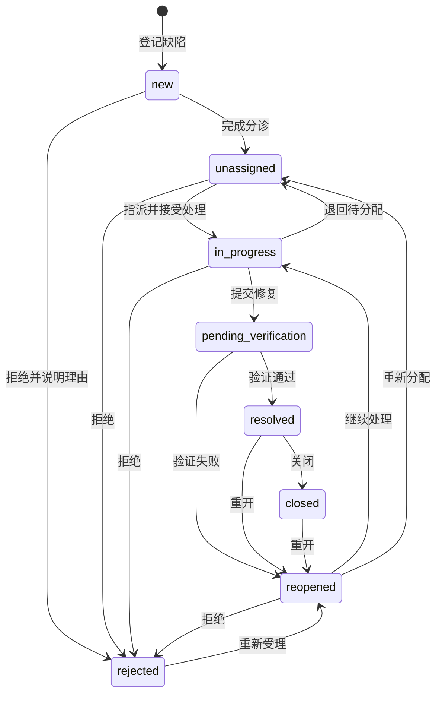
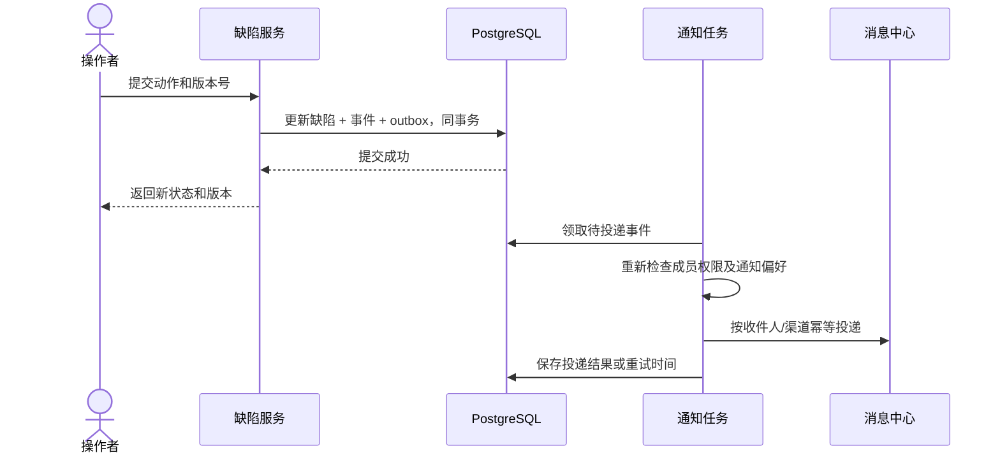

# 缺陷中心企业级重构方案

日期：2026-10-09
交付性质：设计基线；A 批次已实施，具体接口、验收与上线说明见[第一批交付说明](缺陷中心第一批改造交付说明-2026-10-09.md)。B/C 批次仍按本文规划推进。
目标：测试人员提交可复现的问题，负责人分配，开发修复，测试验证，形成可追溯、可统计的项目协作闭环。

## 1. 现状核对与重构边界

本次检查了缺陷模型、路由、缺陷页面、项目权限、报告落库、质量门禁、通知与对象存储代码。下表属于静态代码核对结果，不等同于线上复现报告。

| 当前实现 | 已具备 | 缺口与影响 | 优先级 |
| --- | --- | --- | --- |
| `backend/app/models/database.py` 的 `Defect` | 项目、测试运行、执行用例、标题、描述、五类缺陷、严重程度、复现步骤、AI 分析 | 没有优先级、报告人、处理人、验证人、模块、迭代、版本、协作对象、生命周期时间戳 | P0 |
| `backend/app/api/defects.py` | 登记、详情、分页筛选、状态变更、删除 | 无字段编辑接口；没有分配、验证和关闭的职责校验；`source` 接收入参但没有持久化 | P0 |
| 当前五状态流转 | `open/in_fix/verified/closed/rejected` | `closed` 无出口，不能重开；`open` 可直接关闭；缺少待分配、待验证及明确的解决结果 | P0 |
| `update_defect_status` | 允许流转时写备注 | 备注追加到 `reproduce_steps`，并截取前 50 项，复现信息和历史相互污染，后续记录可能被截掉 | P0 |
| `frontend/src/api/index.ts` 的 `defectsApi.update` | 声明 `PUT /api/defects/{id}` | 后端缺少对应路由，不能据此前端声明认定已支持编辑 | P0 |
| `frontend/src/views/Defects.vue` | 列表、登记弹窗、详情抽屉、流转菜单 | 状态和流转规则在前端重复硬编码；详情直接使用列表行数据；缺少协作、编辑和负责人工作台 | P0 |
| `backend/app/modules/report/generator.py` | AI 分析结果落入缺陷表 | 重生成报告会删除 `open` 缺陷再创建；评论、附件、稳定链接加入后，该策略会破坏资产及协作记录 | P0 |
| `backend/app/api/dashboard.py`、`trend.py` | 按严重程度统计新增趋势 | 内连接 `TestRun`，漏掉无运行关联的手动缺陷；时间过滤使用运行创建时间，可能与缺陷创建时间不一致 | P0 |
| 项目访问控制 | 全局角色、项目负责人、成员 `read/write` 范围、查询及写入隔离 | 没有缺陷业务角色与操作权限；普通成员使用现有成员接口时也无法获取处理人候选，需要单独提供安全的选人接口 | P0 |
| `notifications`、通知偏好、`NotificationManager` | 站内消息、配置及外部渠道适配代码 | 缺陷事件尚未接入可靠投递；外部适配代码存在不代表已完成用户定向投递和失败重试 | P1 |
| MinIO、`audit_logs` | 对象存储工具、通用审计表 | 缺陷附件实体、鉴权下载、完整活动时间线缺失；现有审计辅助函数会提交会话，不能直接用于业务原子事务 | P1 |

约束与范围：

- 延用 Vue 3、TypeScript、Element Plus、现有图标和样式变量；后端延用 FastAPI、Pydantic、SQLAlchemy、PostgreSQL、Celery、Redis、MinIO。
- 保留 `defects.id`、测试运行和执行用例关联，保留报告与用例库的互链；AI 根因和建议仍可查看。
- 保留 `/api/defects` 前缀及 `{code, data, message}` 成功响应，增量扩展能力。
- 当前权限是项目隔离，不是多租户隔离。本方案不以新增缺陷权限替代组织或租户系统。
- AI 可以建议分类、优先级、重复候选及根因；提交修复、验证通过、拒绝和关闭必须经过同一服务端状态机，默认由有权限的人确认。

## 2. 对标能力与产品取舍

| 平台 | 官方资料确认的核心能力 | 本平台采用的设计 |
| --- | --- | --- |
| Jira | 状态、优先级、解决结果分别表达不同含义；流转可以限制操作者、收集输入、校验字段；关注人受项目权限约束 | 拆开严重程度/优先级、状态/解决结果；后端返回可操作动作和必填项；关注与抄送不能赋予资源访问权限 |
| TAPD | 缺陷模型含模块、迭代、发现/验证/修复版本、处理人、抄送人、角色和过程时间；候选值随项目变化 | 按项目获取表单元数据；迭代、版本、人员使用真实项目对象；修复与验证分别记录 |
| 禅道 | 开发处理与测试验证关闭分工明确，支持激活与批量处理 | 修复提交后进入待验证；验证失败可重开；关闭后仍能重开；批量流转逐项检查 |

来源：[Jira 状态、优先级与解决结果](https://support.atlassian.com/jira-cloud-administration/docs/what-are-issue-statuses-priorities-and-resolutions/)、[Jira 流转规则](https://support.atlassian.com/jira-cloud-administration/docs/edit-an-issue-workflow/)、[Jira 关注人接口与权限](https://developer.atlassian.com/cloud/jira/platform/rest/v3/api-group-issue-watchers/)、[TAPD 缺陷字段](https://open.tapd.cn/document/api-doc/API%E6%96%87%E6%A1%A3/api_reference/bug/bug.html)、[TAPD 项目字段候选值](https://open.tapd.cn/document/api-doc/API%E6%96%87%E6%A1%A3/api_reference/bug/get_bug_fields_info.html)、[禅道验证、关闭与激活](https://www.zentao.net/book/zentaopms/530.html?releaseID=26)。TAPD 内容依据官方搜索索引核对，文档页面直接打开时未成功，实施时还应核对届时接口文档。

建议采用测试平台需要的协作能力：不在本次引入完整需求排期系统、任意脚本工作流或与三家平台的双向同步。模块、迭代和版本提供轻量项目目录，后续可对接外部研发系统。

## 3. 字段模型与表结构

### 3.1 修改 `defects`，保留原字段

严重程度表示影响，优先级表示处理顺序。历史 `severity=P0…P3` 继续保留；界面显示“致命/严重/一般/轻微”。新增优先级使用 `urgent/high/normal/low`，显示“紧急/高/普通/低”，避免把历史严重程度误当成优先级。

| 新增/修改字段 | 类型与约束 | 语义及默认值 |
| --- | --- | --- |
| `defect_key` | VARCHAR(40)，唯一、非空 | `BUG-0000123`；由全局数据库序列生成，允许跳号，不使用 `COUNT+1` |
| `priority` | VARCHAR(16)，非空，限定四种值 | 默认 `normal`；不根据历史严重程度自动推断 |
| `module_id` | UUID，FK `project_modules`，可空 | 所属模块；模块停用不影响历史引用 |
| `iteration_id` | UUID，FK `project_iterations`，可空 | 所属迭代；归属与修复目标可在详情中调整 |
| `environment_profile_id` | UUID，FK `environment_profiles`，可空 | 所属环境；必须属于同一项目 |
| `environment_revision_id` | UUID，FK `environment_profile_revisions`，可空 | 如源于运行，绑定当次环境修订版 |
| `environment_snapshot` | JSONB，非空，默认 `{}` | 环境名称、服务地址、操作系统、浏览器、构建号等；禁止复制 token、密码、认证配置 |
| `preconditions` | TEXT，可空 | 前置条件 |
| `expected_result`、`actual_result` | TEXT，可空 | 预期与实际结果，独立于描述 |
| `reproduce_steps` | 保留 JSONB | 继续保存有序字符串数组；只保存复现步骤，不再混入评论与流转备注 |
| `reproducibility` | VARCHAR(16)，非空 | `always/intermittent/once/unknown`，默认 `unknown` |
| `reporter_id`、`assignee_id`、`verifier_id` | UUID，FK `users`，可空 | 报告人、处理人、验证人；报告人由登录身份确定，自动发现可关联任务发起人并标记系统来源 |
| `fix_submitted_by_id`、`resolved_by_id`、`closed_by_id` | UUID，FK `users`，可空 | 实际提交修复、验证通过、关闭的操作者；不能用目前的处理人/验证人倒推历史操作者 |
| `source` | VARCHAR(20)，非空 | `manual/pipeline/import`；由服务端入口决定，客户端不能冒充系统来源 |
| `source_metadata` | JSONB，非空 | 运行、结果、模型版本、导入任务等来源信息；与 AI 分析内容分开 |
| `workflow_state` | VARCHAR(64)，非空 | 新状态机的真实状态；为自定义状态预留长度 |
| `workflow_revision_id` | UUID，FK `defect_workflow_revisions` | 缺陷绑定不可变的工作流修订版 |
| `status` | 保留 VARCHAR(20) | 旧客户端的五状态投影，由服务端计算，不能作为新状态机依据 |
| `proposed_resolution` | VARCHAR(32)，可空 | 修复提交时的建议结果；默认流程只支持 `fixed` |
| `resolution` | VARCHAR(32)，可空 | `fixed/duplicate/not_a_bug/wont_fix/cannot_reproduce/legacy_unknown`；通过验证或拒绝后设置 |
| `resolution_note` | TEXT，可空 | 解决说明或拒绝理由 |
| `duplicate_of_id` | UUID，FK `defects`，可空 | 重复缺陷的主缺陷；同项目、非自身，禁止重复关系环 |
| `fix_release_id`、`verified_release_id` | UUID，FK `project_releases`，可空 | 修复版本与验证版本；不能默认等于发现版本 |
| `fix_build`、`verified_build` | VARCHAR(200)，可空 | 未纳入版本目录时记录真实构建号；不能用空字符串满足流转校验 |
| `labels` | JSONB 字符串数组，非空，默认 `[]` | 去空、去重，最多 20 个，每个最多 40 字符 |
| `due_at` | TIMESTAMPTZ，可空 | 约定解决期限，用于逾期统计 |
| `assigned_at`、`started_at`、`fix_submitted_at` | TIMESTAMPTZ，可空 | 当前处理周期的里程碑 |
| `resolved_at`、`closed_at` | TIMESTAMPTZ，可空 | 当前周期验证通过/关闭时间，重开时清空；历史时间保存在事件中 |
| `first_resolved_at` | TIMESTAMPTZ，可空 | 首次真正验证通过的时间，后续重开不覆盖 |
| `reopened_count` | INTEGER，非空，默认 0 | 事件派生缓存，不允许客户端直接修改 |
| `updated_at`、`deleted_at`、`deleted_by` | 时间/用户 FK | 更新时间、软删除时间、删除操作者；新增时间使用 UTC |
| `row_version` | INTEGER，非空，默认 1 | 乐观锁版本；编辑、分配、流转均递增 |
| `creation_request_id` | UUID，可空 | 手工创建的幂等键；同报告人、项目、请求键唯一，重复请求内容不同返回 409 |

原有 `defect_type` 五种枚举继续使用，已满足首批分类；暂不修改 PostgreSQL 枚举。以后如需业务自定义类型，增加独立 `type_key` 和类型字典，保留旧枚举投影，不能把任意类型直接写入旧枚举。

保留 `is_resolved`，其含义限定为“修复已通过验证”：新流程 `resolved/closed` 为 true；待验证、拒绝、重开为 false。不使用它计算所有终态或是否积压，拒绝也是终止处理但不是修复成功。

### 3.2 新增表清单

下列新表均使用 UUID 主键、UTC 时间，业务记录带 `project_id`。有 `defect_id` 的表使用 `(defect_id, project_id)` 复合外键到 `defects(id, project_id)`，防止协作记录挂到其他项目；为此增加父表唯一约束。不可变事件与已发布配置使用 `RESTRICT`，不能级联删除历史。

| 表 | 主要字段、唯一约束与用途 | 批次 |
| --- | --- | --- |
| `project_modules` | `project_id, parent_id, name, path, is_active, sort_order`；项目/路径唯一；禁止父子跨项目及目录环 | A |
| `project_iterations` | `project_id, name, start_date, end_date, status`；项目/名称唯一；检查起止日期 | A |
| `project_releases` | `project_id, name, build_ref, released_at, status`；项目/名称唯一；`planned/released/archived` | A |
| `defect_affected_releases` | `defect_id, project_id, release_id`；缺陷/版本唯一；影响版本支持多选 | A |
| `defect_references` | `defect_id, project_id, kind, requirement_doc_id, requirement_item_key, case_asset_id, related_defect_id, relation, title_snapshot`；`kind` 决定唯一允许的目标列；需求、用例、相关/阻塞缺陷链接 | A |
| `defect_events` | `defect_id, project_id, sequence, event_type, actor_id, actor_kind, from_state, to_state, changes_json, note, request_id, occurred_at, recorded_at, is_legacy`；缺陷/sequence 唯一，缺陷/request_id 非空时唯一；追加式字段及状态历史 | A |
| `defect_occurrences` | `defect_id, project_id, test_run_id, test_case_id, test_result_id, case_asset_id, signature, signature_version, observed_at, evidence_json`；运行/签名版本/签名唯一；保留多次检测证据及稳定落库标识 | A |
| `defect_workflows` | `project_id, name, active_revision_id, created_by, updated_at`；项目/名称唯一 | A 建默认对象；C 配置 UI |
| `defect_workflow_revisions` | `workflow_id, project_id, revision, status, definition_json, published_by, published_at`；工作流/revision 唯一；`draft/published/retired` | A 默认修订版；C 编辑发布 |
| `project_defect_settings` | `project_id` 主键；`default_workflow_id, permission_config, field_config, notification_config, row_version`；权限、字段要求与事件订阅策略 | A 默认配置；C 编辑 UI |
| `project_defect_role_assignments` | `project_id, user_id, role_key`；三列联合唯一；项目内可同时是开发和测试；添加角色仍要求现有项目成员或负责人身份 | A |
| `defect_comments` | `defect_id, project_id, author_id, body, mention_user_ids, row_version, created_at, edited_at, deleted_at`；软删除留痕；活动事件存编辑前后摘要 | B |
| `defect_watchers` | `defect_id, project_id, user_id, kind, created_by`；缺陷/用户/kind 唯一；`cc/watch` 分开管理，发送通知时去重 | B |
| `defect_attachments` | `project_id, defect_id?, comment_id?, uploader_id, filename, content_type, size, sha256, object_key, status, created_at, deleted_at`；`staged/ready/failed/deleted`；未绑定文件仅上传人可见，设置到期清理 | B |
| `notification_outbox` | `project_id, event_id, payload, status, attempts, next_attempt_at, locked_until, last_error, created_at`；事件 ID 唯一；与事件在一个业务事务中提交 | B |
| `notification_deliveries` | `outbox_id, user_id, channel, status, attempts, delivered_at, last_error`；outbox/用户/渠道唯一；投递幂等和失败可追踪 | B |
| `defect_views` | `project_id, owner_id, name, visibility, query_json, columns_json, sort_json, row_version`；`private/project`；共享视图不会授予项目访问权 | B |
| `defect_jobs` | `project_id, creator_id, kind, status, request_key, input_hash, input_key, result_key, summary_json, expires_at, created_at, completed_at`；创建人/项目/kind/请求键唯一；导入、导出、工作流迁移任务 | B；C 复用 |
| `defect_daily_metrics` | `project_id, date, timezone, definition_version, dimension_key, dimensions_json, metrics_json, calculated_at, history_coverage_from`；项目/日期/时区/口径版本/dimension_key 唯一；维度键由规范化维度生成 | C，大量数据时启用 |

需求关联不新增一个不成熟的“需求管理平台”：引用已有 `requirement_docs`，并保存解析结果中的需求条目 key 和标题快照。文档修订后找不到原条目时显示“原条目已变化”，不得悄悄关联其他条目。无稳定条目 key 的旧文档先只允许文档级关联。

执行用例 `test_cases` 与可复用用例资产 `test_case_assets` 继续区分：原字段 `test_case_id` 保留一次执行的证据；新引用和 occurrence 可指向用例资产，用于关联缺陷与回归计划。

### 3.3 需要修改的其他表与索引

- `notifications` 增加可空的 `source_event_id`、`resource_type`、`resource_id`、`dedupe_key`，`dedupe_key` 非空时唯一；继续使用现有列表、未读数和标记已读接口。
- `defects` 增加 `(project_id, workflow_state, updated_at DESC, id)`、`(project_id, assignee_id, workflow_state)`、`(project_id, module_id)`、`(project_id, iteration_id)`；列表索引通常只覆盖未软删除数据。
- 标签使用 GIN 索引；大数据量关键字搜索再启用全文索引，不在首批要求新增 Elasticsearch。
- `defect_events`：`(defect_id, sequence)`、`(project_id, occurred_at, event_type)`；`defect_occurrences`：`(defect_id, observed_at)`。
- `notification_outbox`：待投递记录的 `status/next_attempt_at` 索引；任务表 `creator_id/status/created_at` 索引。
- `ProjectMember.access` 和 `UserRole` 保持现状；通过独立项目角色表增强缺陷职责，不用数据库枚举扩展替代权限设计。
- 全部关联校验同时检查“操作者能访问”与“关联对象属于缺陷同一项目”。只检查前者不足以防止两个可访问项目之间串数据。

## 4. 生命周期与操作留痕

### 4.1 默认工作流

“待验证”表示开发已提交修复、等待测试；“已解决”表示测试验证通过；“已关闭”表示项目负责人或测试人员完成归档。这样三个状态分别对应不同责任和时间点。团队也可在发布自定义工作流时合并验证通过与关闭，但必须保留相应语义事件。



状态编码：`new` 新建、`unassigned` 待分配、`in_progress` 处理中、`pending_verification` 待验证、`resolved` 已解决、`closed` 已关闭、`reopened` 重开、`rejected` 拒绝。

待分配可以已有候选处理人，但尚未接受；界面提供“待认领/未指派”子筛选。分配是独立动作：可以改处理人但不隐式改变状态。列表流转按钮使用服务端返回的动作名，不能任意选择状态值。

| 动作 | 起点 → 终点 | 默认操作者 | 服务端必查项 |
| --- | --- | --- | --- |
| `triage` 完成分诊 | 新建 → 待分配 | 项目经理/测试负责人 | 标题、严重程度、优先级、描述；启用严格字段时补齐模块及环境说明 |
| `assign` 指派/转派 | 状态不变 | 项目经理/测试负责人 | 处理人启用、属于本项目并有处理权限；转派处理中/待验证缺陷必须写原因 |
| `start` 接受处理 | 待分配 → 处理中 | 当前处理人 | 已指派；具备修复权限；负责人代操作须明确原因 |
| `submit_fix` 提交修复 | 处理中 → 待验证 | 当前处理人 | 修复说明，修复版本或构建号，验证人，修复已可在指定环境验证；不自动认定已修复 |
| `verify_pass` 验证通过 | 待验证 → 已解决 | 验证人/测试负责人 | 验证说明、实际验证版本或构建号；写 `resolution=fixed`、验证人和时间 |
| `verify_fail` 验证失败 | 待验证 → 重开 | 验证人/测试负责人 | 失败原因、实际结果；保留本次修复证据，清空当前周期解决结果 |
| `close` 关闭 | 已解决 → 已关闭 | 验证人/测试负责人/项目经理 | 已验证；不得由新建直接跳转；重复点击不会重复生成事件 |
| `reopen` 重开 | 已解决/已关闭/拒绝 → 重开 | 报告人、验证人、测试负责人、项目经理 | 必填理由；清空当前解决结果、时间及修复提交字段，累加重开次数；原证据留在事件 |
| `resume` 继续处理 | 重开 → 处理中 | 当前处理人 | 同 `start` |
| `return_to_queue` 退回 | 处理中/重开 → 待分配 | 当前处理人/测试负责人/项目经理 | 必填原因，允许解除指派；不能删除既有处理记录 |
| `reject` 拒绝 | 新建/待分配/处理中/重开 → 拒绝 | 项目经理/测试负责人 | 理由与解决结果；`duplicate` 必须给出有效主缺陷；待验证先完成验证，不直接拒绝 |

默认禁止开发以“提交修复”代替验证通过。紧急代操作允许项目经理执行，但必须授权且记录原因；“允许本人验证本人修复”作为项目配置，默认关闭。没有可用验证人时保留在处理中并提示管理员补充成员，不能静默跳过验证。

本人验证校验比较本周期真实的修复提交操作者与实际验证操作者，不能仅比较当前 `assignee_id`，否则转派后会绕过限制。重开清空当前周期操作者字段，历史操作者保留在事件中。

延期修复使用 `due_at`、迭代和优先级表达，不自动当作“已解决”或“拒绝”。

### 4.2 原子事务、并发与事件

统一服务流程：鉴权与同项目校验 → 读取并检查 `row_version` → 检查绑定工作流及动作 → 校验输入 → 条件更新行版本 → 写事件、审计行和 outbox → 提交一次事务。

- 所有写操作要求 `expected_version`；`UPDATE ... WHERE id=:id AND row_version=:expected` 未更新到行时返回 409，保留用户输入并提示刷新。
- 流转提交包含 `request_id`；同缺陷同请求键、同 payload 重试返回第一次成功结果，内容不同返回 409。幂等检查必须先于版本冲突判断。
- 非法动作/缺字段返回 422；无权限 403；无读取权限的资源按现有风格返回 404，不能泄漏标题及处理人。
- `defect_events` 只追加。字段更新记录变更前后值、操作者、事件时间与请求号；评论编辑、删除和附件移除也产生事件。
- 活动使用每个缺陷递增的 sequence 游标；分配 sequence 时锁定该缺陷行，避免并发评论或字段变更生成相同序号。评论正文另有自己的 row_version，不把别人的新评论当作字段编辑冲突。
- 复现步骤修改作为字段变更事件；流转原因存 `note`，不再写入步骤。
- 不直接复用会内部 `commit()` 的 `AuditService.log`。增加不提交的辅助方法或直接向同一 session 添加 `AuditLog`。
- 缺陷默认为软删除：普通列表隐藏，报告互链仍可返回“已删除”占位，活动历史保留。恢复属于独立权限。永久清理遵循现有管理员清理脚本，不提供普通业务按钮。

## 5. 协作、附件与消息

### 5.1 评论、@ 和活动时间线

- 详情分为“概览、评论、活动、附件、关联对象”。活动可按字段修改/状态/协作事件筛选。
- 评论采用纯文本或受限 Markdown；不允许任意 HTML 执行。`@` 菜单选择用户 UUID，提交 `{body, mention_user_ids}`，服务端验证候选及权限，不用显示名字符串认定收件人。
- 选人接口只返回本项目可协作的启用成员和负责人，保留已离职历史人员的只读显示。
- 作者可编辑/删除自己的评论；项目负责人可删除违规评论；编辑和删除均保留审计历史，普通 UI 显示“已编辑/已删除”。
- 报告人、处理人、验证人、抄送人、主动关注人和被 @ 者按事件订阅策略接收提醒；同一事件对同一用户同一渠道只发一次，默认不提醒操作者本人。

### 5.2 附件

- 复用 MinIO 私有 bucket，对象 key 由服务端生成，包含项目及随机标识；数据库只存 key，不存可公开访问的永久 URL。
- 创建表单可先上传到 `staged`，再通过 `attachment_ids` 绑定缺陷；只能绑定自己上传、同项目、未过期、尚未绑定的文件。取消登记后未绑定文件自动清理。
- 默认单文件上限 20MB、单缺陷总量 200MB，可在项目配置中调整；允许图片、PDF、文本日志及常见办公文档，类型与内容检查一致；首版不接受可执行文件和压缩包。
- 上传完成且数据库提交后才变为 `ready`；失败对象进入补偿清理。同步 MinIO SDK 调用放线程池，不能阻塞 async API。
- 下载先鉴权再由后端流式返回，使用安全的 `Content-Disposition: attachment`；首版不使用现有 24 小时预签名分享工具，防止权限撤销后仍长期访问。
- 截图可预览，文本和 HTML 内容按安全类型展示；避免浏览器直接执行附件。

### 5.3 可靠通知



通知 worker 使用服务会话，但必须显式按项目和有效成员筛选收件人；不能用当前请求的、只允许操作本人通知的 session 为其他人直接插入消息。站内消息可立即写入；外部渠道在免打扰时段延迟，按用户已验证地址/配置发送。没有配置外部渠道时返回配置提示，不伪造发送成功。

投递失败不会回滚已完成的缺陷流转；采用重试、任务租约和唯一约束，超限记录可由管理员重试。收件人被移出项目后停止投递；已存在消息再次展示时检查资源权限，正文降为通用“项目事件”，跳转页仍执行鉴权。

## 6. 查询、视图、批量与导入导出

### 6.1 查询与视图

保留现有查询参数，新增状态多选、优先级、报告人、处理人、验证人、模块、需求、迭代、环境、版本、标签、来源、创建/更新时间区间、逾期及关联缺陷编号筛选。

常用入口：“全部缺陷、分诊队列、分配给我、我报告的、待我验证、我关注的、已逾期”。个人视图不能绕过项目范围；自定义保存视图首版归属一个项目，跨项目内置视图仍按当前权限聚合。

保存筛选使用受限结构：

```json
{
  "schema_version": 1,
  "conditions": [
    {"field": "workflow_state", "operator": "in", "value": ["unassigned", "in_progress"]},
    {"field": "assignee_id", "operator": "eq", "value": "$me"},
    {"field": "labels", "operator": "contains_any", "value": ["支付", "回归"]}
  ],
  "match": "all"
}
```

字段、操作符、列名、排序全部白名单校验，拒绝原始 SQL、任意属性名和无限递归条件。首版支持平铺 AND；更复杂分组在后续明确限制深度与条数后引入。`$me` 在执行时绑定当前用户，不把视图创建人的身份写死。

所有列表使用稳定排序 `updated_at DESC, id DESC`，分页大小最多 100。统计使用相同筛选，不受当前页影响；避免因为一个缺陷关联多个标签/版本/需求而重复计数，关系过滤用 EXISTS。

### 6.2 批量操作

- 支持指派、调整优先级、模块/迭代、添加/移除标签、流转、软删除；普通字段接口不能批量直接改状态。
- 首版最多 100 条，仅对明确选择的缺陷 ID 执行；跨页全选在服务端固定查询快照并明确总数后再提供。
- 默认每条独立事务，返回成功和失败清单；失败包含版本冲突、无权限、状态不允许或必填缺失。不能一条失败让已成功结果显示为“全部失败”。
- 每条请求带版本及动作，复用同一服务函数；操作结果以幂等请求键记录，重试不会产生重复事件。

### 6.3 导入导出

- CSV/XLSX 模板使用稳定字段 key，附中文字段说明；保留“严重程度”和“优先级”两列。
- 导入流程：上传 → 字段映射 → 预校验 → 展示错误与重复候选 → 确认提交 → 显示逐行结果。默认创建新缺陷，不按标题静默覆盖。
- 导入标题、项目、分类、严重程度、优先级、描述、步骤、目录、关联项、负责人等；首版不导入附件、不导入伪造历史、不直接导入任意终态。
- 人员可以用用户名映射，模块/版本/迭代按项目目录映射；不存在的对象提示错误或由有配置权限的用户显式创建，不能导入时暗中创建账号。
- 导入任务保存文件 hash、映射及预校验结果；提交时再次检查权限和引用。超时/重试沿用任务键，已成功行不重复创建。
- 相同标题只提醒可能重复；确定重复可跳过该行、关联主缺陷或继续登记。
- 导出“当前筛选结果”或“已选择记录”，大批量通过后台任务生成文件。提交、生成、下载均检查权限，项目权限改变后旧下载链接不能绕过鉴权。
- 表格导出明确使用字符串类型，CSV 对 `= + - @` 等公式前缀作安全处理；文件限定过期时间、总行数、大小及可见列，不导出环境凭据。

## 7. 度量与数据口径

不能仅增加图表：先有可信事件与时间戳，再计算趋势和时效。默认按项目配置时区聚合，数据库存 UTC，区间采用 `[from, to)`；空日期补 0，未具备历史信息显示缺失而非假数据。

| 指标 | 定义 | 注意事项 |
| --- | --- | --- |
| 新增缺陷 | 当天 `created_at` 的未永久清除缺陷，包含手动、自动和导入 | 使用缺陷时间，不使用任务时间；历史软删除记录仍属于曾发生的新增事件 |
| 验证解决量 | 当天 `verify_pass` 事件数，并提供去重缺陷数 | 同缺陷多个处理周期分开，不把“提交修复”算解决 |
| 关闭量/拒绝量/重开量 | 当天对应事件数和去重缺陷数 | 拒绝不并入修复成功 |
| 当前积压 | 未删除且语义类别为待处理、处理中、待验证的缺陷数，包含重开 | 已解决、已关闭、拒绝不计；另列待验证积压 |
| 日末积压 | 迁移基线 + 创建、重开、终态和删除/恢复事件的状态重放 | 不允许拿今天状态反推任意历史日末积压 |
| 严重程度/优先级/模块/处理人分布 | 当前筛选范围内缺陷去重计数 | 未指派、未归类独立分桶；不自动转换历史优先级 |
| 积压年龄 | 当前时间减创建时间；分 0–3、4–7、8–14、15–30、30 天以上 | 提供总存续年龄与当前周期年龄两个维度 |
| 首次响应时长 | 首次 `start` 减创建时间 | 没有有效事件的历史数据不参与时效统计 |
| 开发修复时长 | 每周期 `submit_fix` 减本周期 `start` | 采用自然时长；工作日历与暂停时长扣除另行配置 |
| 验证等待时长 | 本周期 `verify_pass/verify_fail` 减 `submit_fix` | 未完成验证记录作为等待积压，不塞入已完成样本 |
| 修复闭环时长 | 每成功周期 `verify_pass` 减周期起点（首周期创建，后续重开） | 拒绝样本排除；给中位数/P90、样本数，均值仅作补充 |
| 重开率 | 区间内至少重开一次的、曾验证通过缺陷数 / 同期发生验证解决或重开的缺陷数 | 分子为分母子集，按缺陷去重；验证失败率另外计算，不混用 |
| 逾期量 | 当前积压且 `due_at < now` | 缺少期限的记录不判逾期 |

统计返回 `timezone, definition_version, generated_at, history_coverage_from, sample_count, excluded_legacy_count`。历史无法确定开始/解决时间时保持 NULL，不能用创建时间补造已解决日期。

既有质量门禁和报告口径保持可解释：

- 历史运行报告记录当次发现了多少缺陷，不因后续关闭修改过去报告或门禁结果。
- 新增“项目当前未解决风险”指标使用实时状态和严重程度，不能替换历史运行门禁同名指标。
- 仪表盘 `/defect-trend`、趋势 `/defect` 和项目质量摘要改为调用共用查询/统计服务，保证手动缺陷与项目范围一致。
- `is_resolved` 不再作为唯一统计条件；自定义工作流通过语义类别映射指标。

## 8. 权限与工作流配置

### 8.1 权限交集

有效权限 = 当前全局角色允许的业务范围 ∩ 现有项目访问级别 ∩ 项目缺陷操作权限 ∩ 当前工作流动作条件。

默认角色映射：项目负责人为 `project_manager`；有 write 权限的 `test_manager` 为 `qa_lead`，`tester` 为 `qa`，`developer` 为 `developer`；read 成员只读。显式项目角色分配可以增加职责，但不能突破全局 viewer/auditor 的限制或项目 read 级别。

| 操作 | 项目经理 | 测试负责人 | 测试人员 | 开发人员 | 只读成员 |
| --- | --- | --- | --- | --- | --- |
| 查看/筛选/历史/附件下载 | ✓ | ✓ | ✓ | ✓ | ✓ |
| 新建缺陷、评论、上传证据 | ✓ | ✓ | ✓ | ✓ | — |
| 修改普通字段 | ✓ | ✓ | 自己报告或指定协作范围 | 当前处理缺陷的允许字段 | — |
| 分诊、指派、调整优先级 | ✓ | ✓ | 按项目授权 | 默认只可认领允许认领的缺陷 | — |
| 接受处理、提交修复 | 代操作需理由 | 代操作需理由 | 获得开发职责时 | 当前处理人 | — |
| 验证/关闭 | ✓ | ✓ | 当前验证人 | 默认 — | — |
| 重开 | ✓ | ✓ | 报告人/验证人 | 报告人；其他按项目授权 | — |
| 拒绝、批量流转 | ✓ | ✓ | 按项目授权 | 按项目授权 | — |
| 自己关注、管理自己的视图 | ✓ | ✓ | ✓ | ✓ | 首版只读，不开放业务写入例外 |
| 维护抄送人/共享视图 | ✓ | ✓ | 按项目授权 | 按项目授权 | — |
| 导入/导出 | ✓ | ✓ | 按项目授权 | 按项目授权 | 默认 — |
| 软删除/恢复、配置权限/工作流 | ✓ | 删除可授权，配置默认 — | — | — | — |

全局 admin/super_admin 保留现有管理范围，但状态校验、必填项和留痕仍需执行，不能直接写表绕过流程。auditor 仍按现有规则仅访问合规审计及个人功能，不因为上表“只读成员”而获得业务访问权。

权限 key 使用白名单，例如 `defect.create/edit/assign/start/submit_fix/verify/close/reopen/return_to_queue/reject/comment/attach/watch/manage_cc/import/export/delete/restore/configure`；字段级编辑范围由服务端控制。退回待分配与任意指派分开授权，允许当前处理人退回并不意味着允许其任意改派其他人。

### 8.2 自定义工作流

- 每个项目先绑定默认工作流；缺陷创建时固定修订版，已发布版本不可原地修改。
- 允许配置状态名称、顺序、展示色、流转边、操作角色、操作者关系、必填项及有限副作用；不支持上传 Python/JS 或表达式执行。
- 每个状态必须声明语义类别：`todo/in_progress/verification/done_verified/done_rejected`，以及旧五状态投影。自定义状态也必须能计入一致的指标。
- 验证配置包括：恰好一个初始状态；所有状态可达；可从非终态到达终态；已解决/关闭/拒绝可通过重开动作恢复处理；角色、字段及副作用均在白名单内；不能出现无人能执行的关键边。
- 编辑 → 校验 → 预览不同角色可执行的动作 → 发布。编辑器使用 Element Plus 状态列表和流转规则表，首版不引入新的可视化 UI 库。
- 发布只作用于新缺陷；存量缺陷默认沿用旧修订版。迁移必须先映射状态并预检，再作为后台任务逐条迁移、记录事件和失败清单，不静默更改存量状态。
- 工作流权限只限制已获得的权限，不能新增全局/项目范围之外的访问能力。

## 9. 接口设计

### 9.1 兼容现有接口

| 接口 | 改造 |
| --- | --- |
| `GET /api/defects` | 保留原有参数、分页和统计结构；新增字段/筛选；列表返回核心字段，不返回全部评论；新状态筛选用 `workflow_states` |
| `POST /api/defects` | 扩充字段；保留旧客户端创建方式，项目严格字段配置启用后才要求补充；返回版本和可执行动作；来源由服务端确定 |
| `GET /api/defects/{defect_id}` | 返回实时详情、关联摘要、权限与绑定工作流，不再只复用列表行 |
| `PATCH /api/defects/{defect_id}/status` | 保留为旧请求适配器，调用同一流转服务；不直接更新状态；新 UI 使用动作接口 |
| `DELETE /api/defects/{defect_id}` | 改为软删除，记录事件；成功仍返回原 `deleted: true` |
| `GET /api/dashboard/defect-trend`、`GET /api/trend/defect` | 响应兼容，通过共用服务统计缺陷创建时间，补齐手动缺陷；旧响应不强塞新图表结构 |
| `/api/notifications` | 保留已有消息列表、未读数和已读接口；扩展缺陷事件及资源权限检查 |

旧响应的 `status_code` 保留五状态投影，`status` 保留旧中文显示；新增 `workflow_state`、`workflow_state_label` 供新页面使用。不要直接把八状态塞入旧字段导致旧客户端出现空白标签。

| 新真实状态 | 旧 `status/status_code` 投影 |
| --- | --- |
| `new/unassigned/reopened` | `open` |
| `in_progress/pending_verification` | `in_fix` |
| `resolved` | `verified` |
| `closed` | `closed` |
| `rejected` | `rejected` |

旧接口流转适配：`open→in_fix` 对应接受处理，`in_fix→verified` 仅在真实状态已经待验证时对应验证通过，其他请求提示使用完整动作补齐步骤；`→closed` 仅允许已解决状态，`→rejected` 必须补齐理由及结果。旧接口也不能跳过新校验。此处保持路径和响应延续，原有不严谨流转语义不承诺继续放行。

### 9.2 新增接口与优先级

表中 `{id}` 表示 `defect_id`，实现时参数名称保持一致；所有静态路由如 `metadata/batch/search/export/import-template` 必须注册在动态 `/{defect_id}` 前。

| 模块 | 接口 | 用途 | 批次 |
| --- | --- | --- | --- |
| 元数据 | `GET /api/defects/metadata?project_id=` | 字段候选、模块/迭代/版本摘要、默认工作流和角色能力 | A |
| 重复候选 | `GET /api/defects/duplicates?project_id=&title=&exclude_defect_id=` | 同项目疑似重复提示，不自动合并或禁止新建；限定返回数量 | A |
| 选人 | `GET /api/defects/participants?project_id=&q=&purpose=` | 分页返回可作处理人/验证人/抄送/@ 的成员；无需普通用户调用管理成员接口 | A/B |
| 字段编辑 | `PATCH /api/defects/{id}`、`PUT /api/defects/{id}` | 两条路由共享部分更新 schema，补齐既有前端 PUT 声明；仅更新显式提供字段，禁止状态/系统字段 | A |
| 指派 | `POST /api/defects/{id}/assign` | 改处理人、验证人，校验权限/原因/版本 | A |
| 流转查询 | `GET /api/defects/{id}/transitions` | 返回动作、目标状态、必填项、是否可执行及禁用原因 | A |
| 流转执行 | `POST /api/defects/{id}/transitions` | 按 action_id、字段、版本、请求键执行 | A |
| 历史 | `GET /api/defects/{id}/events` | sequence 游标分页的活动时间线 | A |
| 检测证据 | `GET /api/defects/{id}/occurrences` | 各次运行、请求失败证据及报告跳转 | A |
| 关联 | `POST /api/defects/{id}/references`、`DELETE /api/defects/{id}/references/{reference_id}` | 关联需求、用例和其他缺陷；删除关联有留痕 | A |
| 恢复 | `POST /api/defects/{id}/restore` | 恢复软删除，不覆盖工作流状态 | A |
| 目录 | `GET/POST /api/projects/{project_id}/modules`、`PATCH /api/projects/{project_id}/modules/{module_id}` | 模块树与停用；写接口要求配置权限 | A |
| 迭代/版本 | `GET/POST /api/projects/{project_id}/iterations`、`GET/POST /api/projects/{project_id}/releases`；`PATCH /api/projects/{project_id}/iterations/{iteration_id}`、`PATCH /api/projects/{project_id}/releases/{release_id}` | 轻量项目目录，不强行嵌入需求排期 | A |
| 评论 | `GET/POST /api/defects/{id}/comments`、`PATCH/DELETE /api/defects/{id}/comments/{comment_id}` | 评论、编辑、删除、@，包含版本和请求键 | B |
| 关注与抄送 | `GET /api/defects/{id}/watchers`、`POST/DELETE /api/defects/{id}/watch`、`PUT /api/defects/{id}/cc` | 本人关注/取消，授权维护抄送清单 | B |
| 附件 | `POST /api/defect-attachments` | multipart 上传暂存附件，带 project_id，可带 defect_id/comment_id | B |
| 附件管理 | `GET /api/defects/{id}/attachments`、`GET /api/defect-attachments/{attachment_id}/download`、`DELETE /api/defect-attachments/{attachment_id}` | 列出、鉴权下载、软删除；未绑定文件只属于上传者 | B |
| 高级查询 | `POST /api/defects/search` | 受限查询 DSL；虽然是 POST，鉴权按查询处理，允许只读用户，不产生业务写入 | B |
| 视图 | `GET/POST /api/defect-views`、`PATCH/DELETE /api/defect-views/{view_id}` | 个人/项目视图，列设置、排序与共享 | B |
| 批量 | `POST /api/defects/batch/preview`、`POST /api/defects/batch` | 预检、逐项执行并返回结果 | B |
| 导入 | `GET /api/defects/import-template`、`POST /api/defects/imports/preview`、`POST /api/defects/imports/{job_id}/commit` | 模板、上传预检、确认提交 | B |
| 导出 | `POST /api/defects/exports` | 当前筛选或指定记录导出任务 | B |
| 任务 | `GET /api/defect-jobs/{job_id}`、`GET /api/defect-jobs/{job_id}/download` | 进度/逐行结果/鉴权下载，仅创建者或有管理权限者可访问 | B |
| 统计 | `GET /api/defects/metrics?project_id=&from=&to=&timezone=` | 趋势、分布、积压、时效、口径及样本覆盖率 | C；A 修旧统计 |
| 项目配置 | `GET/PATCH /api/projects/{project_id}/defect-settings` | 字段要求、业务权限、通知和默认工作流 | C |
| 项目角色 | `GET/PUT /api/projects/{project_id}/defect-roles` | 缺陷职责授权；不等于成员 read/write 管理 | C；A 默认映射 |
| 工作流 | `GET/POST /api/projects/{project_id}/defect-workflows`、`GET /api/projects/{project_id}/defect-workflows/{workflow_id}` | 工作流列表/创建/详情 | C |
| 工作流修订版 | `POST /api/projects/{project_id}/defect-workflows/{workflow_id}/revisions`、`PATCH /api/projects/{project_id}/defect-workflows/{workflow_id}/revisions/{workflow_revision_id}` | 从已发布版复制草稿并编辑，仅草稿可编辑 | C |
| 校验/发布 | `POST /api/projects/{project_id}/defect-workflows/{workflow_id}/revisions/{workflow_revision_id}/validate`、`POST /api/projects/{project_id}/defect-workflows/{workflow_id}/revisions/{workflow_revision_id}/publish` | 完整性检查、角色预览、原子发布 | C |
| 存量迁移 | `POST /api/projects/{project_id}/defect-workflows/{workflow_id}/migrations/preview`、`POST /api/projects/{project_id}/defect-workflows/{workflow_id}/migrations` | 映射预检及带留痕的迁移任务 | C |

### 9.3 核心请求与响应示例

登记请求（示例中的 UUID 为演示标识，实际必须来自当前项目元数据）：

```json
{
  "project_id": "11111111-1111-4111-8111-111111111111",
  "title": "提交订单时优惠金额计算错误",
  "description": "满减与会员折扣同时使用时订单金额偏高",
  "defect_type": "business",
  "severity": "P1",
  "priority": "high",
  "module_id": "22222222-2222-4222-8222-222222222222",
  "preconditions": "已登录会员账号，购物车商品满足满减条件",
  "reproduce_steps": ["加入指定商品", "选择满减券", "提交订单"],
  "expected_result": "按约定优惠顺序计算应付金额",
  "actual_result": "会员折扣未生效",
  "environment_profile_id": "33333333-3333-4333-8333-333333333333",
  "affected_release_ids": ["44444444-4444-4444-8444-444444444444"],
  "assignee_id": "55555555-5555-4555-8555-555555555555",
  "labels": ["订单", "回归"],
  "references": [],
  "attachment_ids": [],
  "creation_request_id": "66666666-6666-4666-8666-666666666666"
}
```

流转请求：

```json
{
  "action_id": "submit_fix",
  "expected_version": 4,
  "request_id": "77777777-7777-4777-8777-777777777777",
  "note": "修正优惠叠加顺序，已完成开发侧回归",
  "fields": {
    "fix_build": "orders-20261009.3",
    "verifier_id": "88888888-8888-4888-8888-888888888888",
    "fix_available": true
  }
}
```

`fix_available` 是本次动作确认输入，连同操作者和环境信息保存在事件中，不是证明部署成功的 CI 信号。后续接入 CI 后可提供构建证据，仍不能仅依据构建成功认定验证通过。

成功响应：

```json
{
  "code": 0,
  "data": {
    "id": "99999999-9999-4999-8999-999999999999",
    "defect_key": "BUG-0000123",
    "status_code": "in_fix",
    "status": "修复中",
    "workflow_state": "pending_verification",
    "workflow_state_label": "待验证",
    "row_version": 5,
    "is_resolved": false,
    "event_id": "aaaaaaaa-aaaa-4aaa-8aaa-aaaaaaaaaaaa"
  },
  "message": "修复已提交，等待验证"
}
```

错误保留 FastAPI HTTP 状态与 `detail` 风格，可结构化返回 `detail={error_code, message, field_errors, current_version}`。前端拦截器需兼容字符串与对象两种 detail，不能把对象显示为 `[object Object]`。

批量返回 `data={succeeded:[...], failed:[{id,error_code,message,current_version}]}`，HTTP 200 表示请求已处理，不代表每条记录成功；前端分别显示数量并保留失败行选中。

## 10. 前端交互与代码边界

### 10.1 缺陷工作台

- 延续现有导航“缺陷中心”及图标。项目上下文固定项目；全局入口允许切换有权限项目，列表和统计同步切换。
- 顶部统计保留简洁卡片：当前积压、严重未解决、待我验证、已逾期；进入 C 批次后增加趋势看板页签。
- 第二行是内置/自定义视图；筛选栏保留关键字、状态、处理人、严重程度，“更多筛选”打开侧面板；不要把全部字段堆成一行。
- 默认列：编号/标题、状态、严重程度、优先级、处理人、模块、更新时间。可配置列；操作列只留“查看、流转、更多”。
- 勾选后出现批量工具栏，先预检再确认；操作说明显示所选记录数量和可能失败原因。
- 列表空态根据“无数据”和“筛选无结果”分别提供登记/导入入口或清除筛选；请求失败显示重试，不伪装成无缺陷。

### 10.2 登记与详情

- 桌面登记使用约 760px 抽屉，移动端全屏；基础信息、复现信息、关联与协作分组。标题/项目/描述/严重程度/优先级为基础必填，其他由项目元数据决定。
- 复现步骤动态增删、上移/下移；预期与实际分开输入，选择环境、影响版本、模块与需求时只显示当前项目候选。
- 提供“保存”和“保存并继续”；保存后定位并高亮新记录；重复候选提示允许查看，不按标题强制禁止创建。
- 未保存内容在抽屉关闭、路由切换和刷新时拦截；更换项目时清空不再有效的目录、人员、版本及附件引用并提示。
- 详情通过 `GET /{id}` 加载实时数据，支持 `/defects/{id}` 独立 URL，同时保留抽屉快捷查看。报告、通知、用例库均跳转到同一详情地址。
- 标题区显示编号、标题、真实状态、负责人及服务端动作；流转弹窗只展示该动作需要的字段与校验，不是“随便选择状态”。
- 中间显示描述、步骤、预期/实际、证据；侧栏显示人员、优先级、目录、迭代、环境、版本与标签；下方页签显示评论、活动、附件、检测记录。
- AI 根因及修复建议独立区域，标记“AI 建议”与来源时间，不能冒充人工确认根因。
- 版本冲突保留表单，显示当前更新者与更新时间，允许刷新后重新提交；不自动覆盖别人的修改。
- 图标按钮有 aria-label，键盘可操作，状态不用颜色作为唯一提示；窄屏使用卡片和横向滚动区，核心操作始终可见。

### 10.3 建议文件职责

| 文件/目录 | 调整 |
| --- | --- |
| `backend/app/api/defects.py` | 只负责请求校验、调用服务、响应；静态路由顺序明确 |
| `backend/app/schemas/defects.py` | 创建、部分更新、动作、评论、批量、查询及配置 schema |
| `backend/app/modules/defects/service.py` | 登记、编辑、分配、流转、软删除、版本锁和单次事务 |
| `backend/app/modules/defects/workflow.py` | 定义校验、动作条件、状态语义、历史接口适配 |
| `backend/app/modules/defects/permissions.py` | 全局/项目/职责交集及字段权限 |
| `backend/app/modules/defects/query.py`、`metrics.py` | 统一筛选、去重和统计口径 |
| `backend/app/modules/defects/collaboration.py`、`attachments.py` | 评论/@/关注与附件生命周期 |
| `backend/app/modules/defects/import_export.py`、`tasks.py` | 导入预校验、导出、通知及迁移任务 |
| `backend/app/models/database.py`、`backend/alembic/versions/` | 增量 ORM 模型与版本化迁移，不继续扩大启动时随意 ALTER 的逻辑 |
| `backend/app/modules/auth/project_scope.py`、`access_policy.py` | 新资源隔离、嵌套/批量引用校验、查询类 POST 的权限分类 |
| `backend/app/modules/report/generator.py` | 改为稳定 occurrence 落库；不删除重建缺陷 |
| `backend/app/api/dashboard.py`、`trend.py`、`case_library.py` | 复用缺陷查询，兼容趋势响应及关联缺陷状态 |
| `frontend/src/types/defects.ts` | 领域类型，区分真实状态、旧投影、动作与解决结果 |
| `frontend/src/api/index.ts` | 扩展统一 defectsApi，替换页面散落的 raw api 请求 |
| `frontend/src/views/Defects.vue`、`DefectDetail.vue` | 工作台、独立详情与路由互链 |
| `frontend/src/components/defects/` | 登记/编辑抽屉、筛选、步骤编辑、流转、评论、附件、活动、批量对话框 |
| `frontend/src/views/workspace/ProjectDefectSettings.vue` | 项目字段、权限、工作流编辑发布及迁移入口 |
| `frontend/src/router/index.ts`、通知跳转、项目质量页 | 新详情/配置路由，权限和深链一致 |
| `backend/scripts/cleanup_test_data.py` | 新表纳入清理及引用顺序；工作流基线应能重新初始化，不影响保留 AI 模型配置的约定 |

代码目录是实施建议，并非本轮已创建的生产代码。

## 11. 自动发现、迁移与上线策略

### 11.1 自动发现改造

1. 报告生成先构造稳定的检测签名：运行 ID、真实测试结果/执行用例标识、断言位置、错误分类；包含签名算法版本，不用 AI 改写后的标题作唯一键。
2. 同一次检测重复落库时复用 occurrence 与缺陷 ID。并发依靠唯一约束；未命中既有 occurrence 才创建新缺陷及 `created` 事件。
3. 报告重生成不删除任何缺陷；用户修改字段、评论、附件、处理状态不被 AI 结果覆盖。
4. 跨运行相似故障给出“疑似重复”候选，首版默认创建独立缺陷并可手动归并，不按相同标题自动归并，也不自动重开历史缺陷。
5. 明确归并后多次 occurrence 连接同一主缺陷，重复子缺陷以 `resolution=duplicate` 留存。自动化通过可以给待验证缺陷提供证据，默认仍由验证人执行验证动作。

### 11.2 历史数据迁移

迁移脚本先预检并输出 dry-run 报告，备份数据库和附件索引，按批次执行 Alembic 迁移；当前迁移文件最高编号为 018，实际实施时按届时仓库 head 分配编号。

| 历史情况 | 迁移策略 |
| --- | --- |
| `project_id` 为空且有合法 test_run | 通过运行补齐归属项目 |
| 无法确定项目 | 进入管理员“待归属”清单，普通成员不可见；不按旧模型注释中的“全局可见”放开权限 |
| `open` | `unassigned`，不假设曾分诊或已经分配 |
| `in_fix` | `in_progress`，缺处理人标为待补充，不能伪造人员 |
| `verified` | `resolved`，`resolution=legacy_unknown`，不声称已有可信验证人或修复日期 |
| `closed` | `closed`，结果未知时 `legacy_unknown` |
| `rejected` | `rejected`，保留未知理由标记，后续重开补资料 |
| NULL 状态 | `is_resolved=true` 映射 resolved，否则 unassigned；异常状态进入预检报告，不能静默丢弃 |
| 复现步骤中混入旧备注 | 先原样保存历史快照；符合旧备注格式的条目仅作为“疑似历史备注”展示，人工确认后分离；不能用正则自动删除正常步骤 |
| 缺少报告人、时间、环境 | 保持 NULL/未知；不以当前管理员和迁移时间冒充历史操作者/解决时间 |

每个历史缺陷创建一条 `legacy_imported` 基线事件，记录迁移时当前状态和完整旧快照；`occurred_at` 为迁移时间、`is_legacy=true`，不得把基线事件当作过去的创建/解决事件。历史创建时间仍保留在缺陷字段中。

历史 `resolved` 的 `legacy_unknown` 不足以通过新流程的关闭校验。需要有权限的负责人重开、补齐修复与验证资料后再关闭；已关闭历史记录原样保留，不强行重新进入积压。

旧自动发现缺陷依据真实执行结果尝试补 occurrence；没有稳定证据的记录只标记旧来源。未建立映射的历史运行第一次重新生成报告时显示迁移提示，不能批量删除或按猜测签名匹配。

### 11.3 兼容切换

- 先扩表与回填，再上线服务端兼容层，然后发布新前端；灰度项目先启用，监控 409/422、通知失败和统计差异。
- 兼容期双写 `workflow_state` 与旧 `status/is_resolved` 投影，仅由同一领域服务完成，不允许各入口自行转换。
- 严格字段、通知外部渠道、自定义工作流分开开关；关闭新 UI 开关仍保留新服务端校验。
- 回退版本必须包含兼容服务与软删除过滤，不能回退到会删除重建缺陷的老报告代码。上线前准备兼容补丁；数据回滚仅在停止写入并验证备份后操作。
- 清理脚本、备份恢复、新环境初始化一并验证，保留用户此前“清理测试数据但保留 AI 模型配置”的能力。

## 12. 分批实施与验收

P0：阻断闭环或破坏数据的问题；P1：团队日常协作与管理；P2：可信指标与项目可配置能力。优先级不表示承诺完成日期，下面以可独立验收的批次实施。

| 批次 | 模块与范围 | 验收标准 |
| --- | --- | --- |
| A：P0 核心闭环 | 字段扩展、项目目录和关联、责任人选取、八状态默认流程、编辑接口、独立事件、乐观锁、项目职责默认值、稳定自动发现、软删除、旧统计漏数修正 | 测试提交→负责人分诊/指派→开发修复→测试验证→关闭→重开完整跑通；复现步骤不会因流转改变；重生成报告保持 ID 与处理记录；两人并发编辑不会覆盖；手动缺陷出现在原趋势统计中 |
| B：P1 团队协作与管理 | 评论/@、抄送/关注、附件、可靠站内通知、多条件筛选、自定义视图、批量预检/操作、CSV/XLSX 导入导出 | 不同角色在真实项目权限下收到准确通知；附件撤权后不可下载；跨项目关联被拒绝；导入重试不重复；批量逐项失败清晰；筛选/导出数量一致 |
| C：P2 指标与项目配置 | 事件趋势、积压、时效、口径说明、配置权限/字段/通知、自定义工作流草稿/发布/迁移 | 看板能追溯样本与事件；未知历史不伪造；发布不改存量；迁移有预检/映射/留痕；权限配置不能突破全局与项目边界 |

每批同时修改后端与前端并验收，不能先展示无接口支持的操作按钮。A 批次必须完成三种登录身份的真实闭环，B/C 在此基础上扩展。

必须覆盖的验证场景：

1. 新建缺陷的字段校验、同项目引用、启用成员、来源不可伪造、幂等重试、连续登记及未保存拦截。
2. 每条合法流转、非法跳转、本人修复本人验证限制、拒绝必填原因、重复缺陷主对象约束、关闭后重开。
3. 并发编辑/转派/流转的版本冲突，重复动作请求只生成一个事件；事务失败不留下半条历史或孤立通知。
4. 两个项目的列表/聚合/详情/嵌套批量/评论/附件/视图/导出任务隔离；read、viewer、auditor 均不能越权写入。
5. 手动缺陷、流水线缺陷及历史缺陷的统计一致；午夜时区、零数据、重开多周期、拒绝和未知时间样本口径正确。
6. 报告重生成与并发报告任务保持缺陷 ID、评论、附件、人工编辑；检测签名冲突和无稳定历史证据场景可解释。
7. @ 同名用户、停用用户、撤销项目权限、通知免打扰、渠道失败重试及去重。
8. 附件暂存取消/过期、上传失败补偿、越权下载、类型/大小限制、恶意文件名和 HTML 内容。
9. 导入预检后的成员权限变化、重复提交、部分失败；导出公式前缀、过期文件和权限撤销。
10. 旧接口/报告/用例关联/通知深链兼容；数据库迁移 dry-run 与回退演练；管理员清理后模型配置仍保留。

首批重点应放在“能分工、能闭环、记录不丢、数据不串”。在这些条件满足前，复杂图形工作流、外部双向同步和 AI 自动裁决应保持关闭。

## 13. 本轮交付与后续落地入口

本轮交付本设计与 `docs/defect-center/workflow.default.json` 默认工作流配置样例。该 JSON 是可核验的设计契约，不是已经接入生产的运行配置；其中字段和权限 key 与本方案相同。

实施 A 批次时，先完成版本化迁移、统一领域服务和权限校验，然后同时交付登记/详情/流转前端；开发不能将示例配置当成任意 JSON 执行引擎。
